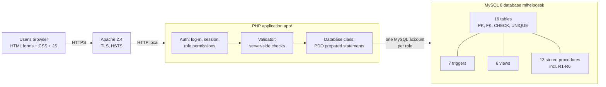

# 02 – Project Structure and Architecture

## 1. Folder structure

```
Part2_Development/
├── README.md                     overview and quick start
├── setup.sh                      builds the database (runs scripts 01-04, then the tests)
├── start.sh / stop.sh            start MySQL + web server / stop MySQL
│
├── database/                     ── MySQL: everything inside the database ──
│   ├── 01_create_tables.sql          16 tables with keys, constraints and indexes
│   ├── 02_views_triggers_procedures.sql  6 views, 7 triggers, 13 procedures (incl. reports R1-R6)
│   ├── 03_pilot_data.sql             pilot data (Design Doc Table 30)
│   ├── 04_security_roles.sql         MySQL roles, accounts and GRANTs (least privilege)
│   ├── 05_queries_and_reports.sql    multi-table queries and R1-R6 (evidence, read-only)
│   ├── 06_validation_tests.sql       41 automated PASS/FAIL tests (rolled back)
│   └── tools/generate_pilot_data.py  how 03_pilot_data.sql was produced
│
├── app/                          ── PHP: the application ──
│   ├── cli/scheduled_backup.php      nightly 18:00 backup (run by the scheduler)
│   ├── config/
│   │   ├── config.php                app settings (timeouts, backup folder, paths)
│   │   └── database.php              MySQL account for each role
│   ├── src/                          PHP classes (not reachable from the web)
│   │   ├── bootstrap.php             loaded by every page: config, session, errors
│   │   ├── helpers.php               e(), url(), flash(), form_field() …
│   │   ├── Database.php              PDO connections per role, prepared statements, CALL
│   │   ├── Auth.php                  log-in, lock-out, session timeout, PERMISSIONS matrix
│   │   ├── Csrf.php                  form tokens against cross-site request forgery
│   │   ├── Validator.php             server-side validation (layer 2)
│   │   ├── DbError.php               database errors → user-friendly messages
│   │   ├── Lookup.php                drop-down lists
│   │   ├── Maintenance.php           backup / restore / compact / integrity check
│   │   └── Reports.php               definitions of R1-R6
│   ├── templates/                    header (role-based menu), footer, access-denied page
│   ├── public/                       ← the ONLY folder the web server serves
│   │   ├── index.php                 Login
│   │   ├── main.php                  Main Control Page
│   │   ├── logout.php
│   │   ├── calls/                    new, followup, assign, resolve, open, view
│   │   ├── reports/                  index (menu), view (R1-R6)
│   │   ├── registers/                offices, employees, hardware, software, technicians
│   │   ├── maintenance/index.php     backup, restore, compact, log
│   │   ├── users/index.php           user accounts (Admin)
│   │   ├── api/                      employee.php, hardware.php (JSON auto-fill)
│   │   └── assets/                   css/style.css, js/app.js
│   └── storage/
│       ├── backups/                  mlhelpdesk_YYYYMMDD_HHMM.sql (last 14 kept)
│       └── logs/                     app.log (errors), apache_*.log, schedule.log
│
├── deploy/                       ── running it for real ──
│   ├── apache/httpd-mlhelpdesk.conf  Apache 2.4 + HTTPS front end
│   ├── apache/start_apache.sh        start/stop Apache, creates the certificate
│   └── schedule/install_schedule.sh  nightly backup + MySQL at log-in (launchd)
│
├── tests/                        ── tests beyond the database tests ──
│   ├── performance_test.php          NFR-01: 50,000 records, timings
│   ├── performance_results.md        last results
│   ├── browser_test.py               NFR-09: real browser (Chrome / Firefox)
│   └── browser_results_chrome.md     last results
│
└── docs/                         ── this documentation ──
    └── screenshots/chrome/           27 screenshots taken by the browser test
```

## 2. Architecture: three layers



| Layer | Technology | Job |
|---|---|---|
| Presentation | HTML5, CSS, a little JavaScript | Screens from the wireframes. Instant checks such as `required`, `pattern` and drop-downs |
| Application | PHP 8.2 | Log-in and roles, server-side validation, calls to the database |
| Data | MySQL 8.0 | Stores data. Enforces integrity with constraints and triggers, and security with GRANTs |

This is the **three layers of validation** of Design Document Section 8.1. A mistake missed by the browser is caught by PHP, and anything PHP misses is refused by MySQL.

## 3. How one page works

Every file in `public/` follows the same pattern:

```php
require dirname(__DIR__, 2) . '/src/bootstrap.php';   // 1. config, session, error handling
Auth::requirePermission('call.log');                  // 2. log-in + role check (403 if not allowed)

if (is_post()) {
    Csrf::check();                                    // 3. reject forged forms
    $v = new Validator($_POST);                       // 4. server-side validation
    ...
    Database::call('sp_LogNewProblem', [...]);        // 5. prepared statement / stored procedure
    flash('success', '...');  redirect('...');        // 6. message + redirect (no double submit)
}
render('header', ['title' => '...']);                 // 7. show the screen
```

## 4. Coding conventions

* **SQL:** table and column names in PascalCase, the same as the data dictionary. Constraints are named `pk_`, `fk_`, `uq_`, `chk_`. Objects are prefixed `vw_` (view), `trg_` (trigger) and `sp_` (procedure).
* **PHP:** `declare(strict_types=1)`, one class per file in `src/`, and all output escaped with `e()`. User input is never joined into SQL; it is always bound with `?`.
* **Secrets:** passwords live only in `config/database.php` (MySQL accounts), and bcrypt hashes in `AppUser`.
