# 05 – System Flows (flow by flow)

Each flow lists what the user does, what the system does, the PHP file and database objects used, and the data that moves. The flowcharts use Mermaid; they render in VS Code (Markdown Preview Mermaid extension), GitHub and draw.io.

---

## 0. Overview – how data moves through the system

### Context diagram (DFD level 0)

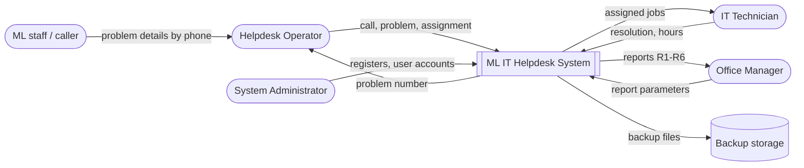

### Level-1 data flow diagram

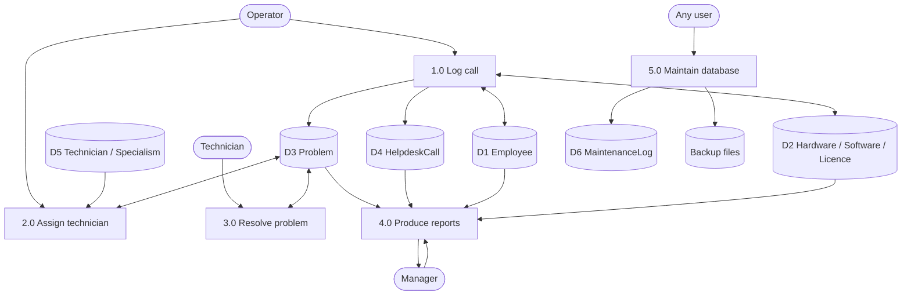

---

## F1. Log in

**Who:** everyone · **File:** `public/index.php` → `Auth::attempt()` · **DB account:** `ml_auth`

1. The user enters a username and password and clicks **Log in**.
2. The browser checks that both fields are filled (`required`).
3. PHP checks the CSRF token, then reads the account from `AppUser` + `Employee`.
4. If the account is locked or belongs to an ex-employee, it is refused with a message.
5. `password_verify()` checks the password against the bcrypt hash.
   * Wrong password: `FailedLogins + 1`. At 5 the account is locked (`IsActive = FALSE`).
   * Right password: `FailedLogins = 0`. The session is regenerated and the role stored.
6. The user lands on the **Main Control Page**, which shows only the menu groups for their role.

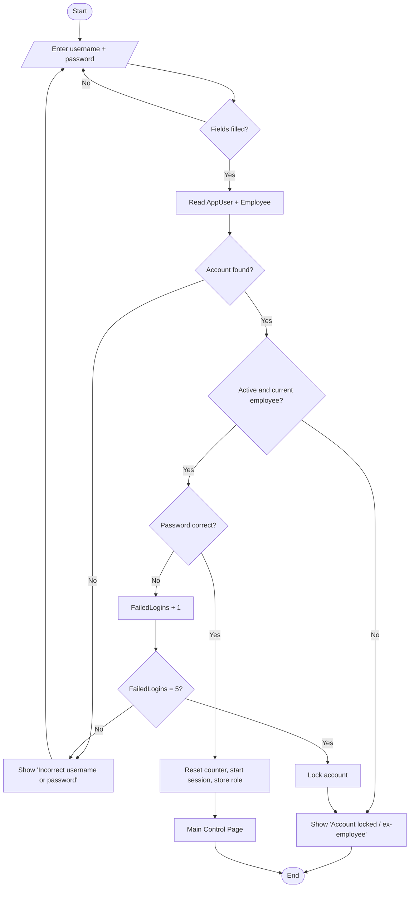

**Data:** reads `AppUser`, `Employee`; updates `AppUser.FailedLogins / IsActive`.

---

## F2. Log a new call

**Who:** Helpdesk Operator · **File:** `public/calls/new.php` · **DB:** `sp_LogNewProblem`, `trg_Problem_BeforeInsert`, `trg_HelpdeskCall_BeforeInsert`

1. The operator chooses the **caller** from the personnel register (current employees only). Job title, department and office fill in automatically (`api/employee.php`, UR-02).
2. The operator types the **serial number**. Type, make, model, a **warranty badge** and the installed software with licence status fill in (`api/hardware.php`, UR-03/04).
3. The operator chooses the OS, software (labels show **Valid licence / NO valid licence**), problem type, priority and urgency. Then they type the **reason for call** and the **description**.
4. **Save & Assign** asks “Save this call?” (verification).
5. PHP validates: caller is current, serial exists, lists, reason ≥ 3 chars, description ≥ 10 chars.
6. `CALL sp_LogNewProblem(...)` in **one transaction**:
   * INSERT `Problem`: the trigger checks the reporter is employed. Status = Open, DateTimeLogged = now.
   * INSERT `HelpdeskCall` (CallType = New): the trigger checks the logger is an Operator.
   * COMMIT. If anything fails, everything is rolled back.
7. The new **problem number (P-000066)** is shown for the operator to read to the caller. The page opens **Assign Technician** (F3).

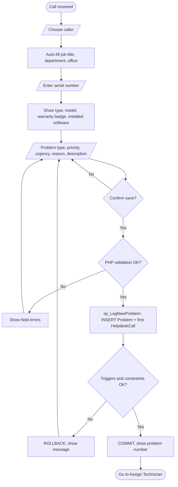

**Data:** reads `Employee`, `Department`, `Office`, `Hardware`, `vw_HardwareStatus`, `InstalledSoftware`, `vw_LicenceStatus`; writes `Problem`, `HelpdeskCall`.

---

## F3. Assign a technician (load balancing)

**Who:** Helpdesk Operator · **File:** `public/calls/assign.php` · **DB:** `sp_GetSkilledTechnicians`, `vw_TechnicianWorkload`, `sp_AssignTechnician`, `trg_Problem_BeforeUpdate`

1. The screen shows the problem number, type and priority.
2. `sp_GetSkilledTechnicians(type)` lists **only technicians with that specialism**, with their **open jobs** count. Available technicians come first, then the fewest open jobs.
3. The least busy available technician is **pre-selected and marked “recommended”** (UR-08).
4. The operator confirms or picks another and clicks **Assign Selected Technician**.
5. `sp_AssignTechnician` updates `Problem.TechnicianID`. The trigger **refuses a technician without the skill** (FR-09) and stamps `DateTimeAssigned`.

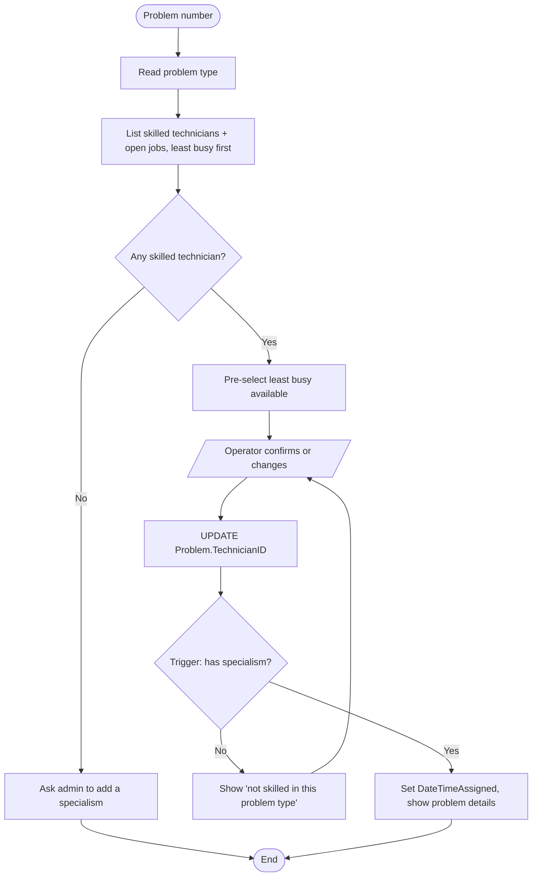

---

## F4. Record a follow-up call

**Who:** Helpdesk Operator · **File:** `public/calls/followup.php` · **DB:** `sp_LogFollowUpCall`

1. The caller quotes their number. The operator enters `P-000066`, `p66` or `66` and clicks **Find**.
2. A read-only summary is shown: caller, equipment, technician, status, number of calls and the original reason.
3. The operator records the caller, **urgency** (Normal / Urgent / Distressed) and the **reason**. The reason is always required (UR-06).
4. `sp_LogFollowUpCall` checks the problem exists and inserts a `HelpdeskCall` with CallType = Follow-up.

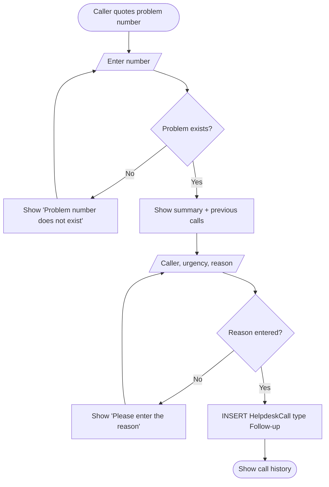

---

## F5. Resolve a problem

**Who:** Operator, or Technician (own jobs) · **File:** `public/calls/resolve.php` · **DB:** `sp_ResolveProblem`

1. A technician sees **My open jobs**. An operator searches by problem number.
2. The user enters the **date/time resolved** (default now), the **time taken in hours** (e.g. 1.5) and **how it was resolved**.
3. PHP checks: all three present, time 0.25–500, resolved after logged and not in the future. A technician may only resolve their own job.
4. `sp_ResolveProblem` repeats the checks. It sets **Status = Closed**, the resolution fields and `ResolvedByUserID`. CHECK `chk_closed` guarantees that no closed problem lacks these fields.

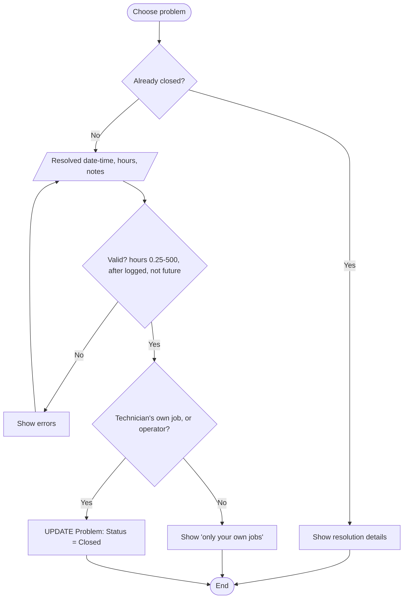

---

## F6. View a management report

**Who:** Office Manager only · **Files:** `public/reports/index.php`, `view.php` · **DB:** `sp_Report_R1` … `sp_Report_R6` (EXECUTE granted to `r_manager` only)

1. The manager chooses the **month**, **technician** (R5) or **office** (R6), and a report.
2. PHP calls the report procedure with the manager's MySQL account.
3. The report shows a header (name, parameters, run by, date), result tables and totals, and a confidentiality footer.
4. **Print / Save as PDF** uses the browser print dialog with a print stylesheet.

| Report | Procedure | Main tables joined |
|---|---|---|
| R1 Monthly calls summary | `sp_Report_R1(y, m)` | HelpdeskCall, Problem, ProblemType, Technician, Employee |
| R2 Technician job sheets | `sp_Report_R2(y, m)` | Technician, Employee, Problem |
| R3 Jobs by office | `sp_Report_R3(y, m)` (NULL = all time) | Office, Employee, Problem, ProblemType |
| R4 Jobs per register item | `sp_Report_R4()` | Hardware, EquipmentType, Manufacturer, Office, Problem, Software, SoftwareLicence |
| R5 Technician detail | `sp_Report_R5(tech, y, m)` | Problem + 8 tables via `vw_ProblemDetail` |
| R6 Office detail | `sp_Report_R6(office, y, m)` | Problem + 8 tables, plus jobs per register item |

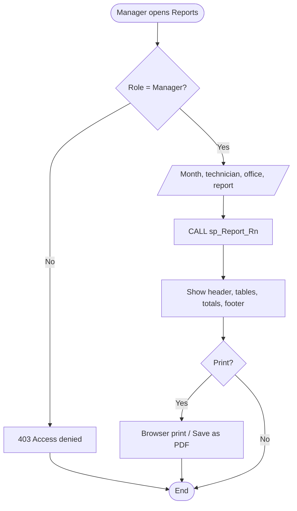

---

## F7. Back up the database

**Who:** everyone (button on the Main Control Page), and the scheduler every night at 18:00 · **Files:** `maintenance/index.php` or `app/cli/scheduled_backup.php` → `Maintenance::backup()` · **DB account:** `ml_backup`

1. The user clicks **Back Up Database Now**, or the scheduler starts `scheduled_backup.php` at 18:00 (Mon–Sat).
2. `mysqldump --single-transaction --routines --triggers` writes `storage/backups/mlhelpdesk_YYYYMMDD_HHMM.sql`. The snapshot is consistent and does not lock other users out.
3. PHP checks that the file exists and is not empty, then keeps only the newest 14 backups.
4. `sp_LogMaintenance` writes a MaintenanceLog row (Success or Failed). A scheduled backup has no user and appears as **Scheduled backup / System**. The file name is shown to the user, or written to `schedule.log` for the scheduler.

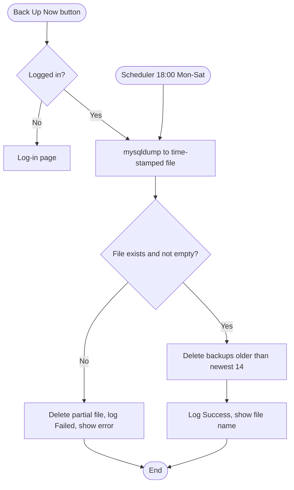

---

## F8. Restore from a backup

**Who:** Helpdesk Operator only · **File:** `maintenance/index.php` → `Maintenance::restore()` · **DB account:** `ml_maint`

1. The operator chooses a backup file and **types its date** (YYYYMMDD) to confirm, then answers “Are you sure?”.
2. The system checks the role (Operator) and that the name is a real backup file.
3. A **safety backup** of the current data is taken first.
4. The chosen file is loaded with the `mysql` client.
5. **If loading fails, the safety backup is loaded back automatically**, so the database is never left half-restored.
6. The result is logged in MaintenanceLog and shown to the user.

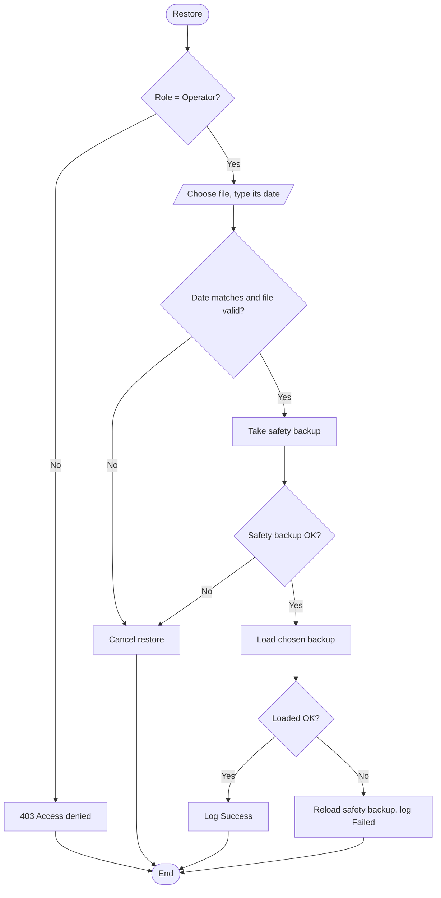

---

## F9. Compact the database

**Who:** Helpdesk Operator only · **DB:** `sp_CompactDatabase`

1. The operator clicks **Compact Now** and confirms.
2. `sp_CompactDatabase` checks that the user is an active Operator. It then runs `OPTIMIZE TABLE` on all 16 tables, which rebuilds the tables and indexes and reclaims unused space.
3. The action is logged in MaintenanceLog.

---

## F9a. Monthly integrity check

**Who:** System Administrator only · **File:** `maintenance/index.php` → `Maintenance::integrityCheck()` · **DB account:** `ml_maint`

1. The admin clicks **Run Integrity Check**. This is also linked from the Main Control Page.
2. The application checks the role (Admin). MySQL does not allow `CHECK TABLE` inside procedures, so the check runs from PHP.
3. `CHECK TABLE` runs on all 16 tables to find corruption early. `ANALYZE TABLE` then refreshes the index statistics so queries stay fast.
4. Every result row is shown with an OK/Failed badge. The outcome is logged with `sp_LogMaintenance`, which refuses Check for non-admins.

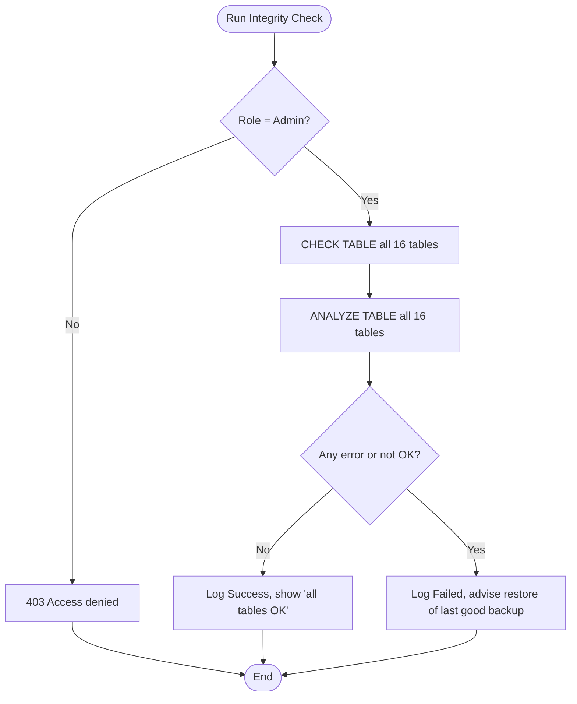

---

## F10. Maintain registers and user accounts

**Who:** System Administrator · **Files:** `registers/*.php`, `users/index.php`

| Task | Steps | Rules enforced |
|---|---|---|
| Add / edit office | form → validate → INSERT/UPDATE `Office` | unique name, phone format, specialisation list |
| Add / edit employee | form → validate → INSERT/UPDATE `Employee` | `E0000` ID, unique email, dates |
| Employee leaves | set **End Date** (never delete) | history kept; can no longer be a caller or log in |
| Add / edit hardware | form → validate → `Hardware`; **Manage installed software** → `InstalledSoftware` | unique serial, warranty ≥ purchase |
| Software & licences | forms → `Software`, `SoftwareLicence` | seats 1–10,000, expiry ≥ start |
| Technicians & skills | tick specialisms → `Technician` + `TechnicianSpecialism` in one transaction | at least one specialism |
| Create account | employee, username, role, password ×2 → `password_hash()` → `AppUser` | 4–30 char username, 8+ char password |
| Unlock account | **Unlock** → `IsActive = TRUE, FailedLogins = 0` | – |

Other roles can open every register **read only**. A POST from them is refused with 403.
