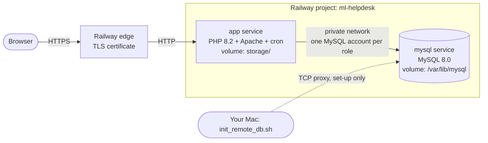

# 07 – Deploying online (Railway)

How to put the ML IT Helpdesk System online on [Railway](https://railway.com). Railway runs Docker containers, so the system runs online exactly as it was built and tested: MySQL 8.0 with all triggers, stored procedures and roles, and PHP 8.2 with Apache.



| Service | Built from | Volume (persistent disk) | Holds |
|---|---|---|---|
| **mysql** | `deploy/railway/mysql/Dockerfile` (MySQL 8.0) | `/var/lib/mysql` | the database |
| **app** | `Dockerfile` (PHP 8.2 + Apache 2.4) | `/var/www/app/storage` | backups and logs |

**Cost:** Railway gives trial credit. After that the two small services cost about US$5 a month (check Railway's pricing page).

---

## Step 1 – Install the Railway CLI and log in

```bash
npm install -g @railway/cli        # or:  brew install railway
railway login                      # opens the browser; sign in with GitHub or email
```

## Step 2 – Create the project

```bash
cd ~/Unit4_Database_Assignment/Part2_Development
railway init                       # choose "Empty project", name it ml-helpdesk
```

In the Railway dashboard (railway.com → your project), create two **empty services** and name them exactly **mysql** and **app** (**+ Create → Empty Service**, then rename).

## Step 3 – Deploy the MySQL service

1. In the dashboard open **mysql → Variables** and add a strong `MYSQL_ROOT_PASSWORD`. Keep it private.
2. Right-click the **mysql** service → **Attach volume**, mount path **`/var/lib/mysql`**.
3. Deploy it from your Mac:

   ```bash
   railway up deploy/railway/mysql --path-as-root --service mysql
   ```

4. Open **mysql → Settings → Networking → TCP Proxy**, enter port **3306**, and note the host and port it shows (for example `shuttle.proxy.rlwy.net:41234`).

## Step 4 – Build the database and set secure passwords

```bash
./deploy/railway/init_remote_db.sh <tcp-proxy-host> <tcp-proxy-port>
```

The script asks for the `MYSQL_ROOT_PASSWORD`. It then:

1. runs scripts 01–04 (tables, views, triggers, procedures, pilot data, roles);
2. gives the 7 application MySQL accounts **new random passwords**, because the pilot ones are published in the scripts;
3. asks for a **new log-in password for all application users**. Set one: the site is public, and Helpdesk2026 is printed in the User Guide;
4. runs the 41 database tests (all must pass);
5. writes the variables for the app to `deploy/railway/app.env`. This file is private and is never committed to git.

After this, you can switch the TCP proxy off again (it is only needed for set-up).

## Step 5 – Deploy the app service

1. **app → Variables → Raw Editor**: paste the contents of `deploy/railway/app.env`, then add:

   ```
   DB_HOST=${{mysql.RAILWAY_PRIVATE_DOMAIN}}
   ```

2. Right-click **app** → **Attach volume**, mount path **`/var/www/app/storage`**.
3. Deploy:

   ```bash
   railway up --service app
   ```

4. **app → Settings → Networking → Generate Domain**. Railway gives a public HTTPS address such as `ml-helpdesk-production.up.railway.app`.

## Step 6 – Check it

| Check | Expected |
|---|---|
| Open the domain | Sign in page over HTTPS |
| Log in as `a.khan` with the new password | Main Control Page (operator) |
| Log in as `i.shah` → Management Reports → R1 | Report with data |
| Any user → Back Up Database Now | “Backup saved as mlhelpdesk_….sql” |
| `w.anwar` → Maintenance → Run Integrity Check | “Integrity check passed” |
| `railway logs --service app` | Apache access lines, no PHP errors |

The nightly backup runs inside the app container at 18:00 Pakistan time, Monday–Saturday. Its output is in `storage/logs/schedule.log` on the app volume.

## Updating the online system

* **Code change:** `railway up --service app`. Data is not touched.
* **Database change:** run the changed SQL script through the TCP proxy with the MySQL client.

## How the cloud set-up keeps the design's security

| Design requirement | Online |
|---|---|
| Least-privilege MySQL accounts per role | Same 7 accounts, with random passwords only Railway knows |
| HTTPS (NFR-02) | Railway's edge certificate; HSTS header; `Secure` session cookie (`TRUST_PROXY=1`) |
| Database not exposed | MySQL only on Railway's private network (TCP proxy only during set-up) |
| Only `app/public` served | Apache document root = `/var/www/app/public` |
| Backup / restore / compact / integrity check | Same code; MariaDB client tools in the container |
| Nightly backup 18:00 | cron in the app container |

## Troubleshooting

| Problem | Fix |
|---|---|
| Build uses “Railpack” instead of Docker | `railway.toml` sets the Dockerfile builder; make sure you deploy from the right folder |
| MySQL keeps restarting: “data directory has files in it” | The volume must be mounted at `/var/lib/mysql`; the data lives in its `data/` sub-folder |
| App: “Something went wrong” | Check `railway logs --service app`; usually `DB_HOST` or a password variable is missing |
| `Access denied for user 'ml_…'` | The app's variables do not match; run Step 4 again and paste the new `app.env` |
| Backup fails | Check the app volume is attached at `/var/www/app/storage` |
